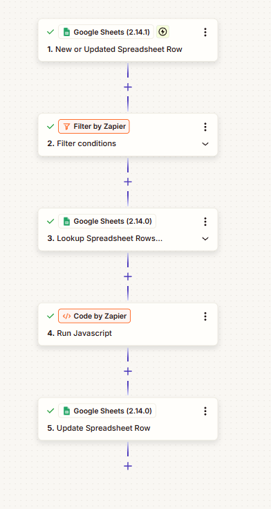
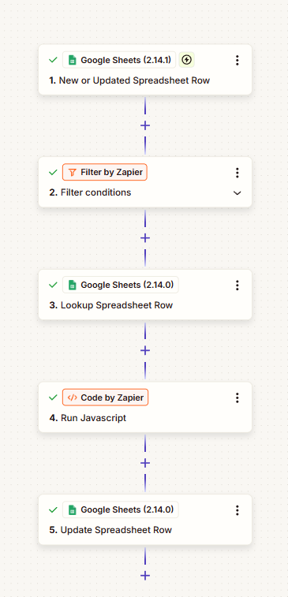

# Apps Script to Zapier Migration

Two Google Sheets workflows from my [Royalty Encoding Sheets Automation](https://github.com/joshuafloresricafort-code/royalty-encoding-sheets-automation) project, rebuilt as Zaps. The logic is the same, but there's no script to maintain and nobody has to click a menu: each Zap runs by itself whenever a row is added or changed.

| | Apps Script version | Zapier version |
|---|---|---|
| **Runs when** | An analyst clicks a custom menu item | A row is added or updated |
| **Scope** | The whole sheet in one batch | One row at a time |
| **Lookups** | Royalty List loaded into an in-memory `Map` | Google Sheets **Lookup Spreadsheet Row(s)** step |
| **Custom logic** | Apps Script | **Code by Zapier** (JavaScript) |
| **Maintenance** | Edit and redeploy the library | Edit the Zap in the visual editor |

🔗 Templates: **[Populate Property Description](https://zapier.com/templates/details/auto-update-property-descriptions-in-google-sheets-303984?secret=MTp0ZW1wbGF0ZTowZmxkeU9GTU9iNEtKZGNBSHBUYi1nZm82cFdhNjBpRmJpSjVZUXJtWkxVOjZ1aTFicw)** · **[Check for Matches](https://zapier.com/templates/details/check-for-matches-in-google-sheets-a006f3?secret=MTp0ZW1wbGF0ZTpXOFBlNjJEbjBRdmhDX1JaWUN6RmU0REFJSV9XRzlkVGZCci1HUWZldzlrOmduNzB1Ng)**

---

## Zap 1: Populate Property Description

1. **Google Sheets:** New or Updated Spreadsheet Row (encoding sheet)
2. **Filter by Zapier:** carries on only for rows that need a description
3. **Google Sheets:** Lookup Spreadsheet Rows, which finds *every* Royalty List row matching the Operator CC
4. **Code by Zapier:** [`code.js`](zaps/populate-property-description/code.js) removes duplicate candidates:
   - **one match:** returns it as the description
   - **several matches:** leaves the description blank and returns all the candidates as `A | B | C` notes for the analyst
5. **Google Sheets:** Update Spreadsheet Row writes the description and notes back

This matches the Apps Script behaviour, which fills a single match and gives multiple matches a dropdown.

 

## Zap 2: Check for Matches

1. **Google Sheets:** New or Updated Spreadsheet Row (encoding sheet)
2. **Filter by Zapier:** carries on only for rows with a Property Description to check
3. **Google Sheets:** Lookup Spreadsheet Row finds the Royalty List row for that description
4. **Code by Zapier:** [`code.js`](zaps/check-for-matches/code.js) converts raw interest codes (`RI`, `ORRI`, `WI`, `NPRI`) to readable labels and passes unknown codes through unchanged
5. **Google Sheets:** Update Spreadsheet Row writes back the Operator CC, product code, interest type, owner % and distribution %

 

---

## Use it yourself

1. Open a template link above and click **Try this template**, or build the five steps by hand.
2. Connect your Google account and point the trigger and update steps at your encoding sheet, and the lookup step at your Royalty List.
3. Paste the matching `code.js` into the Code by Zapier step and map its **Input Data** fields as described in the comments at the top of each file.

---

## Tech

Zapier · Code by Zapier (JavaScript) · Google Sheets · Filter by Zapier · Workflow migration
